# 您好，我是李想 👋

大连海事大学（211）· 测控技术与仪器（双一流学科）
**国家级奖项累计 15 项** · 专业排名 **6/88（前 6.8%）** · GPA **3.91/5.0** · CET-6 **535** / CET-4 **580**

研究兴趣：**机器人感知与定位（视觉 SLAM / 多传感器融合）· 嵌入式控制 · 机械臂系统 · FPGA 数字系统设计**

🏛 **智能控制实验室（爱特学社）· 实验室负责人** ｜ 组员带训 · 项目统筹 · 竞赛队伍管理

> 🤝 **团队担当**：**国家级奖项累计 15 项**，5 次以**队长 / 负责人**身份带队，1 次以**主力队员**身份参与；
> 负责过机械、嵌入式、算法三方向的技术统筹与整机联调。

## 🔥 News

- **2026.11**：获睿抗机器人开发者大赛 **国家一等奖**（**队长**）
- **2026.08**：获 RoboCup 机器人世界杯中国赛「AI+智创未来」**国家二等奖**（**队长**）；中国大学生计算机设计大赛 **国家二等奖**（主力队员）
- **2025.11**：获全国大学生信息安全与对抗技术竞赛（ISCC）**国家三等奖**（**队长**）；立项国家级大创「**全域守护 · 具身看护机器人**」并担任**项目负责人**
- **2025.10**：获 RoboCup 机器人世界杯中国赛 **国家三等奖**（**队长**）
- **2025.08**：获中国机器人及人工智能大赛 **国家三等奖**（**队长**）

## 🏆 荣誉奖项

**国家级奖项累计 15 项**（睿抗、RoboCup、中国大学生计算机设计大赛、ISCC、中国机器人及人工智能大赛等赛事的省赛与国赛阶段获奖）。核心获奖记录如下：

| 时间 | 奖项 | 级别 | 我的角色 |
| --- | --- | --- | --- |
| 2026.11 | 睿抗机器人开发者大赛 · 智能配送与分拣赛道 | **国家一等奖** | **队长** |
| 2026.08 | RoboCup 机器人世界杯中国赛 · 创新创意赛「AI+智创未来」 | **国家二等奖** | **队长** |
| 2026.08 | 中国大学生计算机设计大赛 · 软件开发与应用 | **国家二等奖** | 主力队员 |
| 2025.11 | 全国大学生信息安全与对抗技术竞赛（ISCC）· 智能安全赛 · 医疗配送机器人 | 国家三等奖 | **队长** |
| 2025.10 | 中国机器人大赛暨 RoboCup 机器人世界杯中国赛 · 创新创意赛 · 文化艺术创意 | 国家三等奖 | **队长** |
| 2025.08 | 中国机器人及人工智能大赛 · 机器人任务挑战赛（智慧药房） | 国家三等奖 | **队长** |
| — | 蓝桥杯 | 省二等奖 | **队长** |

- 国家级大学生创新创业训练计划 **项目负责人**（全域守护 · 具身看护机器人，原「多模态医疗护理机器人」，2025.11 立项）

### 🏅 获奖证书

<table>
<tr>
  <td align="center"> <b>2026 RoboCup 中国赛 · AI+智创未来 · 国家二等奖</b> 队伍「Sincerely」· 队长</td>
  <td align="center">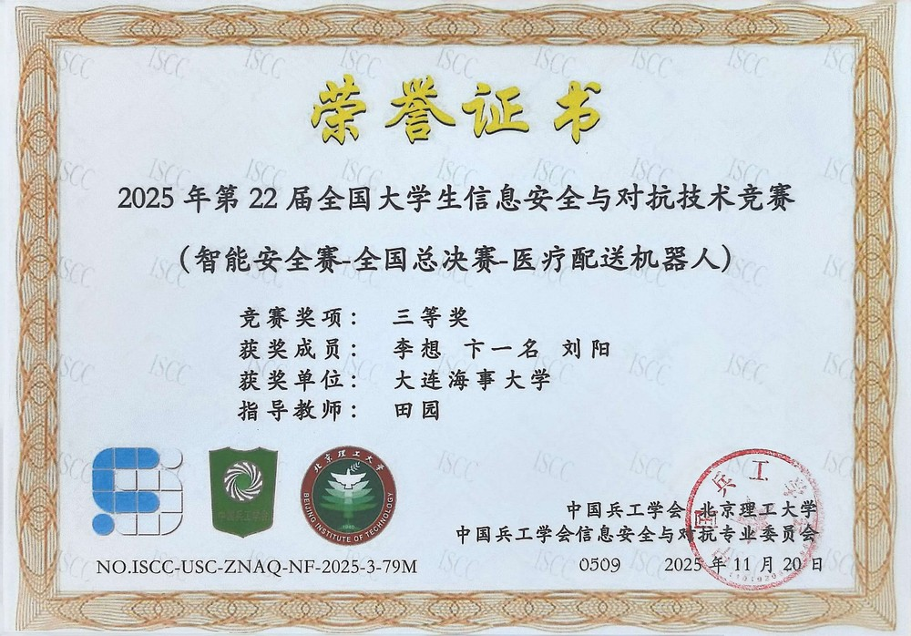 <b>2025 第 22 届 ISCC · 国家三等奖</b> 智能安全赛 · 医疗配送机器人（智慧药房项目）</td>
  <td align="center"> <b>2025 中国机器人大赛暨 RoboCup 中国赛 · 国家三等奖</b> 创新创意赛 · 文化艺术创意 · 队伍「终极规律队」</td>
</tr>
</table>

---

## 🏛 智能控制实验室（爱特学社）· 实验室负责人

- **实验室负责人**：负责实验室日常运营与技术方向把控，组织组员培训、项目选题、方案评审与整机联调；
- **带训与项目化培养**：以「仿真 → 实物 → 赛场」全流程带训 ROS / 嵌入式 / 机械臂等方向项目，多次带队参与睿抗、RoboCup、ISCC、中国机器人及人工智能大赛等**国家级赛事**，取得国一 / 国二 / 国三；
- **团队与技术统筹**：机械、嵌入式、算法三方向的人员分工与接口对接由我统筹，负责从模块联调到赛场落地的全链路把控。

<table>
<tr>
  <td align="center">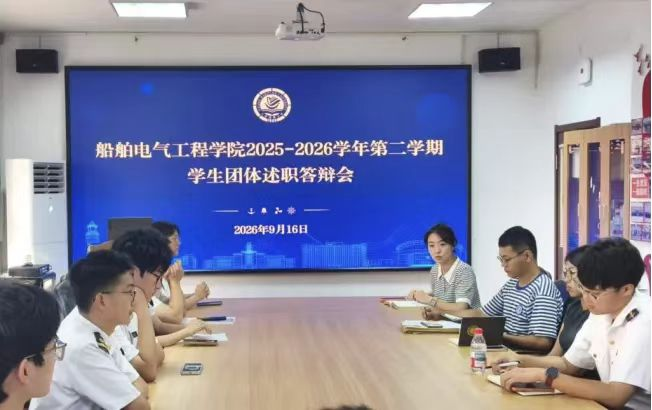 爱特学社学生团体述职答辩会 · 实验室负责人任期内</td>
  <td align="center">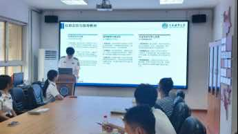 实验室负责人述职答辩：制度建设与团队带训</td>
</tr>
</table>

## 🤖 项目经历

### 1️⃣ 全域守护 · 具身看护机器人（灵犀通感 · 多模态医疗护理机器人）· 国家级大创
**🏷 项目负责人 / 队长** ｜ 2025.11 至今 ｜ SolidWorks · STM32 · 视觉识别 · 多机协同

双机械臂 + 移动底盘形态，面向养老陪护场景：**SolidWorks** 完成整机、双臂与底盘建模装配及爆炸图渲染；**独立开发 STM32 底层电控**（电机驱动、传感器采集、运动控制）；统筹机械、算法两组分工，完成整机联调。

<table>
<tr>
  <td align="center">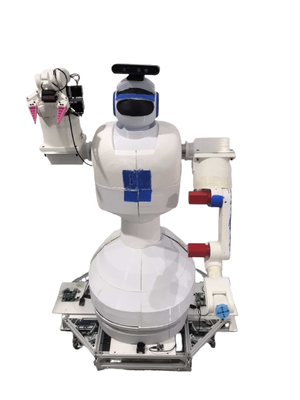 整机三维建模与渲染</td>
  <td align="center"> 整机实物：正面（双臂 + 底盘 + 相机）</td>
  <td align="center">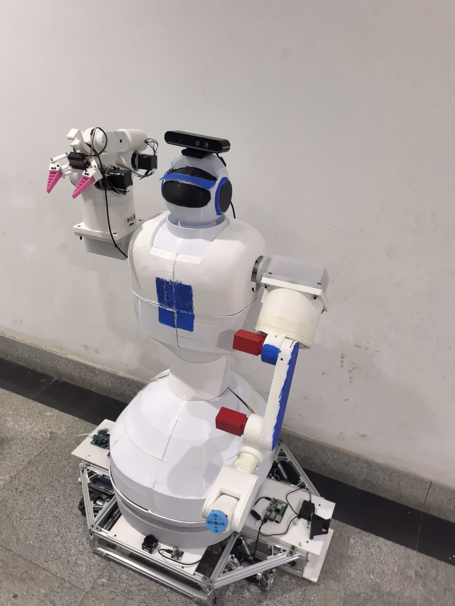 整机实物：三维视角联调</td>
</tr>
<tr>
  <td align="center"> 整机实物联调</td>
  <td align="center">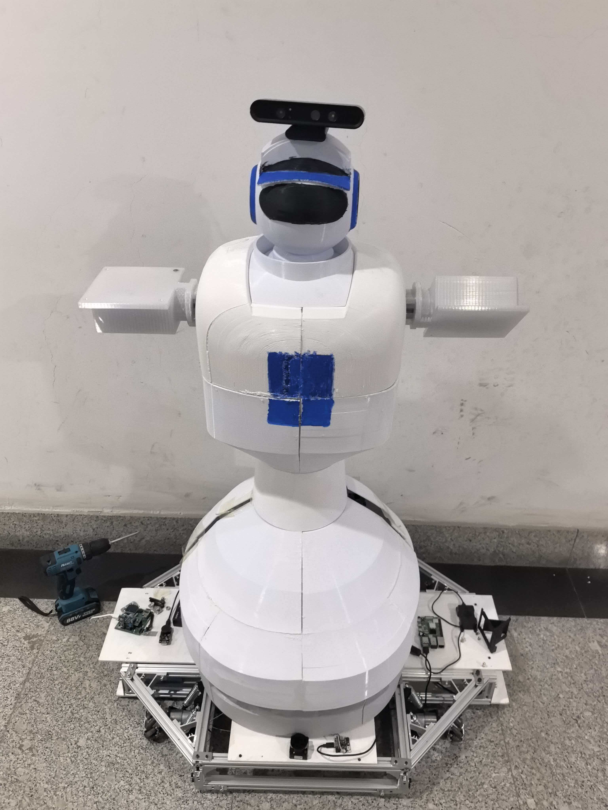 背部结构：双臂、升降躯干与底盘</td>
  <td align="center"> 铝合金底盘装配与电控走线</td>
</tr>
<tr>
  <td align="center"> 3D 打印机械臂与夹爪实物</td>
  <td align="center">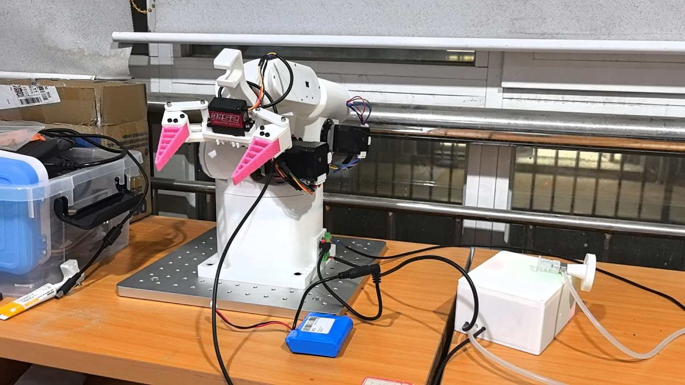 机械臂夹爪对比设计</td>
  <td align="center"> 产品开发历程</td>
</tr>
</table>

<b>🎬 实物运行视频（点击展开）</b>

<table>
<tr>
  <td align="center"><video src="assets/eldercare/arm_demo.mp4" width="320" controls preload="none" poster="assets/eldercare/gripper_real.jpg"></video> 自研 6 自由度机械臂 Demo：关节联动与末端轨迹运动</td>
  <td align="center"><video src="assets/eldercare/arm_demo2.mp4" width="320" controls preload="none" poster="assets/eldercare/gripper_real.jpg"></video> 机械臂取放动作 Demo</td>
</tr>
</table>

🔗 [▶ 直接下载原视频 1](assets/eldercare/arm_demo.mp4) ｜ [▶ 原视频 2](assets/eldercare/arm_demo2.mp4)

### 2️⃣ 虚实结合机械臂：省赛六轴仿真 → 国赛 SCARA 实物 · 睿抗国赛
**🏷 队长** ｜ 国家一等奖 ｜ Webots · OpenCV · 单应性标定 · YOLO11-seg · CAN 总线

**省赛（Webots 虚实结合仿真）**：基于 Webots 搭建六轴机械臂仿真环境并复刻连杆参数、关节限位与相机内参；视觉侧以 **HSV 阈值分割 + 轮廓几何特征**（顶点数 / 凸度 / 圆形度）识别 9 类异形物块并解算像素位姿，经 **八点单应性标定**（相机固定俯视、物块同高的平面假设）把像素坐标映射到台面坐标；控制侧设计 **Client-Server 双向通信**，视觉端下发目标形状与位姿、机械臂端回传 DONE / NEXT / ALIGN 状态，配合多帧稳定冻结与吸盘中心像素误差反馈构成"到位—抓取—校验"闭环。

**国赛（实物落地）**：四个关节模组（1 轴 Z 向升降滑台 + 3 轴旋转关节）经模块化金属连接件装配成 **四自由度 SCARA** 机械臂，整机走 **CAN 总线**驱动；设计 **九点标定**流程，机械臂依次走位到 3×3 采样点、摄像头采集对应像素，解算并保存**像素—板面坐标单应性矩阵**并做精度验证；在此基础上采用**拖动示教**记录关节角，用九点示教数据拟合 SCARA 两连杆非线性经验模型，运行时按"像素→板面坐标→关节角"**查表插值**直接下发关节指令，**不做在线逆运动学迭代**，规避奇异位形附近的数值发散（示教拟合残差均值 0.95mm、留一交叉验证 RMSE 2.88mm；对照旧"像素→机器人 XY 单应性 + IK"方案定位 RMSE 54.94mm 且未通过精度门限）；视觉端改用 **YOLO11-seg 实例分割**（自采数据集微调权重）输出物块掩膜与朝向，与灰度阈值联合判别，配合真空气动夹爪完成传送带物料分拣。

<table>
<tr>
  <td align="center"> 国赛实物 SCARA 机械臂</td>
  <td align="center">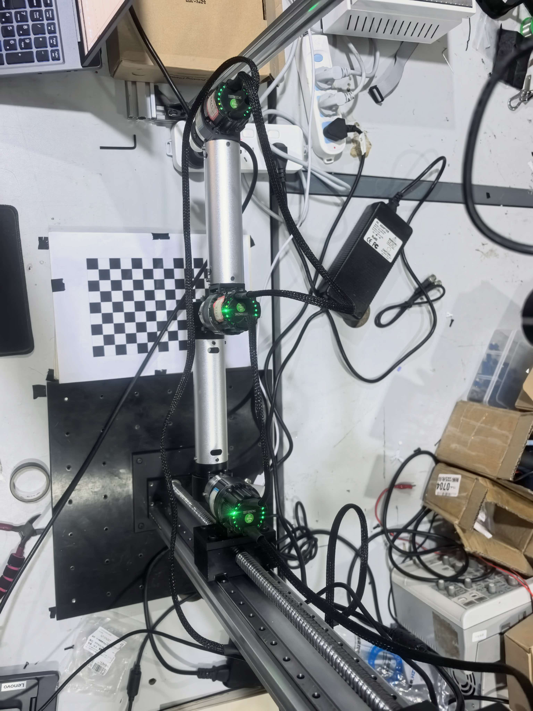 机械臂本体与九点标定工位</td>
  <td align="center">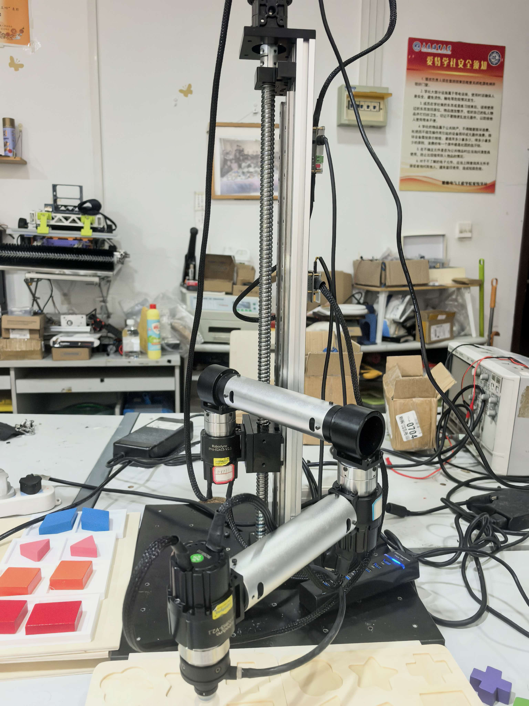 实物分拣工位与彩色物块</td>
</tr>
<tr>
  <td align="center">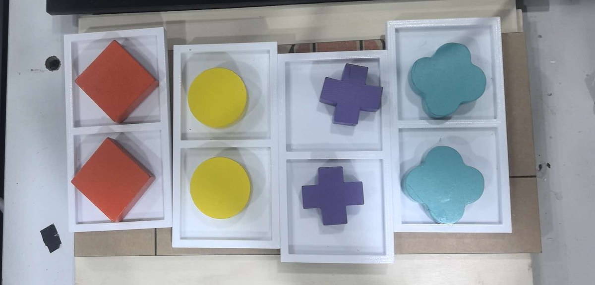 传送带物料分拣目标</td>
  <td align="center">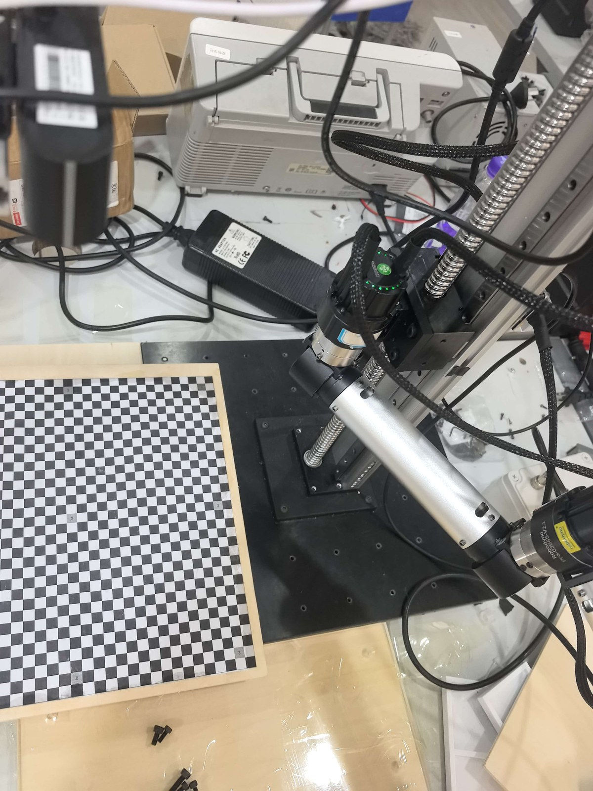 九点标定与视觉-机械臂坐标拟合</td>
  <td align="center"> Webots 虚拟仿真环境</td>
</tr>
<tr>
  <td align="center">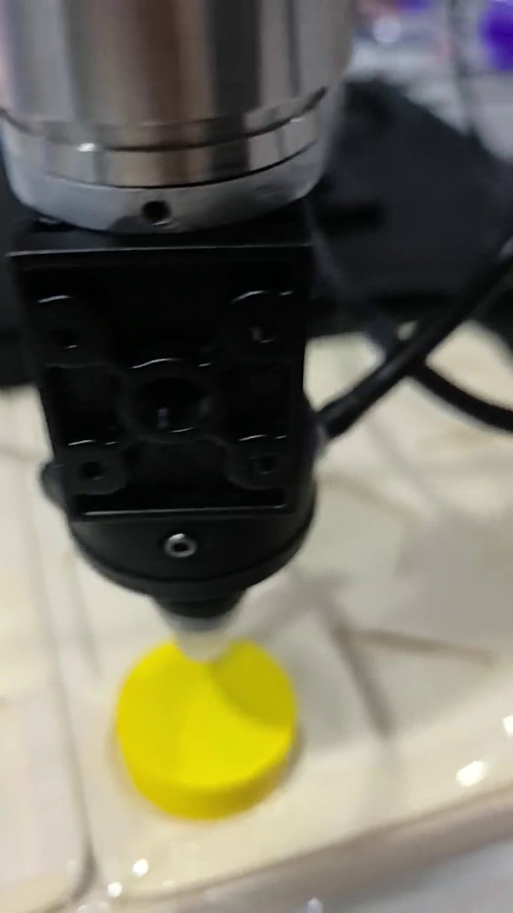 真机运行：末端吸取物块瞬间</td>
  <td align="center">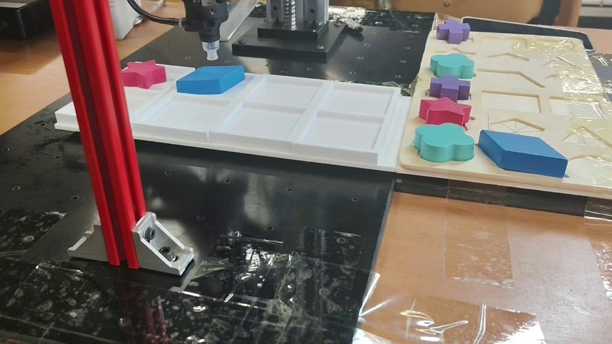 真机运行：分拣料盘与彩色物块</td>
  <td align="center">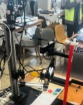 抓取工位实况</td>
</tr>
<tr>
  <td align="center">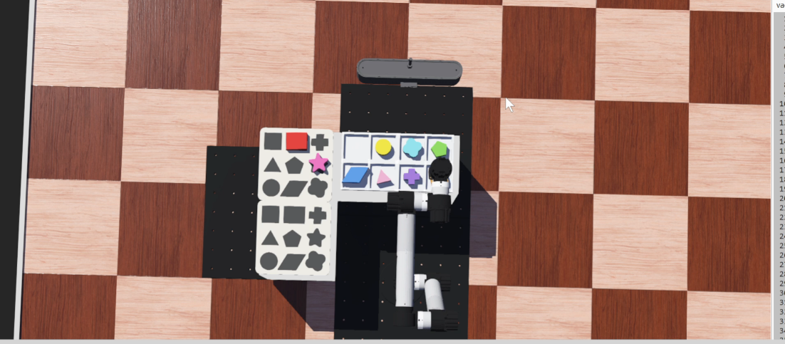 省赛 Webots 仿真：机械臂对位料槽</td>
  <td align="center">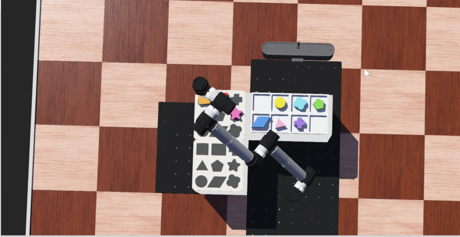 省赛 Webots 仿真：吸取星形物块</td>
  <td align="center">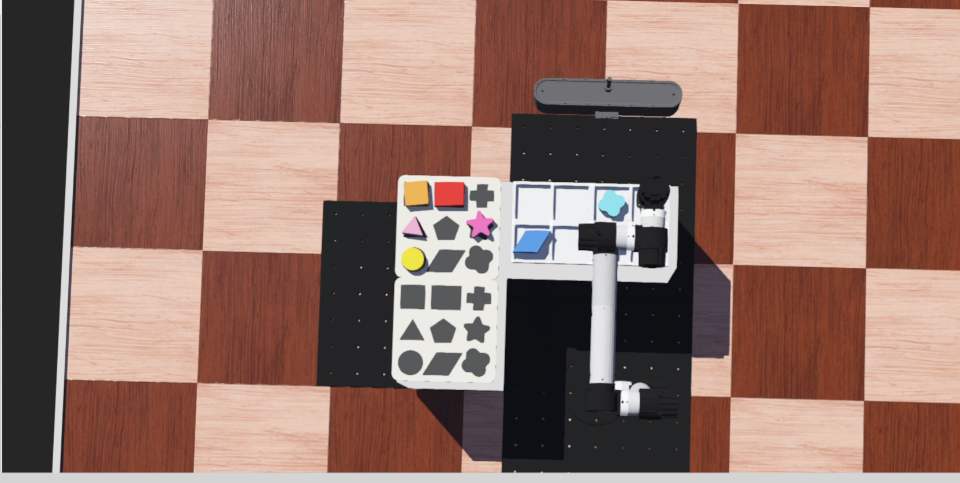 省赛 Webots 仿真：形状识别与分拣</td>
</tr>
</table>

<b>🎬 国赛实物运行视频（点击展开）</b>

<table>
<tr>
  <td align="center"><video src="assets/arm/arm_national_run.mp4" width="320" controls preload="none" poster="assets/arm/arm_national.jpg"></video> 国赛现场：视觉定位 → 吸取物块 → 分拣入槽</td>
  <td align="center"><video src="assets/arm/arm_six_blocks_run.mp4" width="320" controls preload="none" poster="assets/arm/arm_sorting_workcell.jpg"></video> 多物块连续吸取与形状分拣</td>
</tr>
<tr>
  <td align="center" colspan="2"><video src="assets/arm/arm_practice_run.mp4" width="440" controls preload="none" poster="assets/arm/arm_vertical.jpg"></video> 国赛前联调练习：完整抓取与分拣流程</td>
</tr>
</table>

🔗 [▶ 直接下载原视频 · 国赛现场](assets/arm/arm_national_run.mp4) ｜ [▶ 多物块分拣](assets/arm/arm_six_blocks_run.mp4) ｜ [▶ 赛前联调练习](assets/arm/arm_practice_run.mp4)

### 3️⃣ 智慧药房自主配送小车 · CRAIC / ISCC 国赛
**🏷 队长 / 负责人** ｜ 国家三等奖 ×2 ｜ ROS · 激光 SLAM · AMCL · OpenCV · 二维码/OCR

树莓派 + ROS 的 **EPRobot** 小车平台：单线激光雷达 **SLAM 建图**、**AMCL 定位**与 **move_base 路径规划**；OpenCV 轮廓定位 + 二维码/OCR 识别；**有限状态机**调度「扫码-取药-配送-语音播报」全流程，支持多窗口自主配送与双车协同。同一套系统先后拿下 **CRAIC 机器人任务挑战赛（智慧药房）国家三等奖**与 **ISCC 智能安全赛·医疗配送机器人国家三等奖**。

<table>
<tr>
  <td align="center">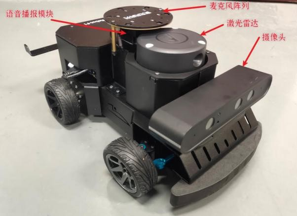 EPRobot 小车硬件组成</td>
  <td align="center">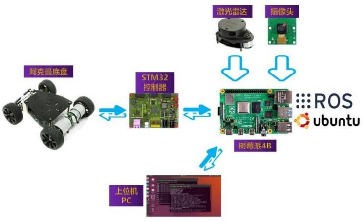 整车软硬件系统架构</td>
  <td align="center">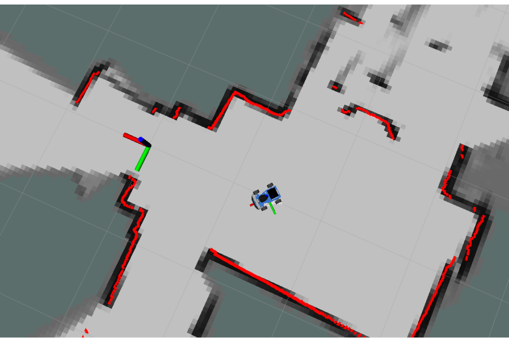 激光 SLAM 建图与路径规划</td>
</tr>
</table>

### 4️⃣ ROSMan 人形机器人 · 智能安全挑战（ISCC 仿人智能体赛题）
**🏷 队长** ｜ 参赛项目 ｜ ROS · Docker · AprilTag · 视觉伺服 · 舵机步态

24 自由度人形机器人（树莓派 5 + Docker + ROS）：**LAB 颜色阈值 + 三段 ROI 视觉检测**、**AprilTag 引导与抗视觉欺骗**、分段 P 控制视觉伺服巡线；**自研跨栏/上下台阶/沙包投掷**舵机步态动作组，Gazebo 仿真验证后真机联调。

<table>
<tr>
  <td align="center">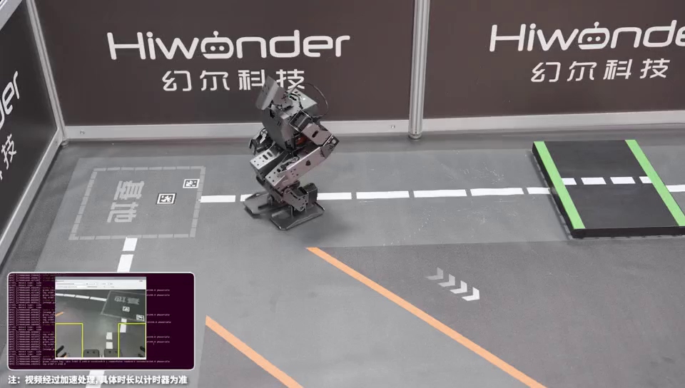 Gazebo 仿真：视觉检测与步态联调</td>
  <td align="center"> 24 自由度人形机器人本体与配件</td>
</tr>
</table>

### 5️⃣ 像素生息 · FPGA 动态音画窗景
**🏷 队长** ｜ 嵌入式芯片与系统设计竞赛 · FPGA 创新设计赛道 ｜ Verilog · SPI/SDRAM/HDMI

以安路 **EG4S20 FPGA** 为核心的桌面音画设备：自主实现 **TF 卡 SPI 读取、FAT32 扫描与 BMP 解析、DDA 定点双线性缩放、SDRAM 三 bank 背景缓存、800×600 HDMI 输出与 48kHz PCM 音画同步**；红外遥控 + 环境光自适应；自主拓展 **PCB 与 3D 打印外壳**完成整机集成，**六时钟域时序零违例**。

<table>
<tr>
  <td align="center"> 整机实拍：HDMI 音画输出与红外遥控</td>
  <td align="center"> 作品海报</td>
  <td align="center"> 自研 3D 打印外壳建模</td>
</tr>
</table>

---

## 📖 教育背景

**大连海事大学（211）** · 测控技术与仪器（双一流学科）
专业排名 6/88（前 6.8%）· GPA 3.91/5.0
核心课程：高等数学下（95）、信号与系统（97）、电路原理（92）、FPGA 可编程逻辑器件（93）

## 🛠️ 技能

- **嵌入式**：51/STM32 单片机开发、电机驱动与运动控制、PCB 绘制（含自主拓展 PCB 设计）
- **机器人**：ROS 节点编写、激光/视觉 SLAM、多传感器融合、move_base 导航、手眼标定与坐标变换、人形机器人步态控制、Webots/Gazebo 仿真
- **FPGA/数字设计**：Verilog、SPI/SDRAM/HDMI 接口开发、多时钟域时序设计
- **工具**：SolidWorks 建模仿真、3D 打印
- **语言**：CET-6（535）/ CET-4（580）

## 📮 联系方式

- 邮箱：3163079468@qq.com
- GitHub：[@2220243081lx](https://github.com/2220243081lx)
